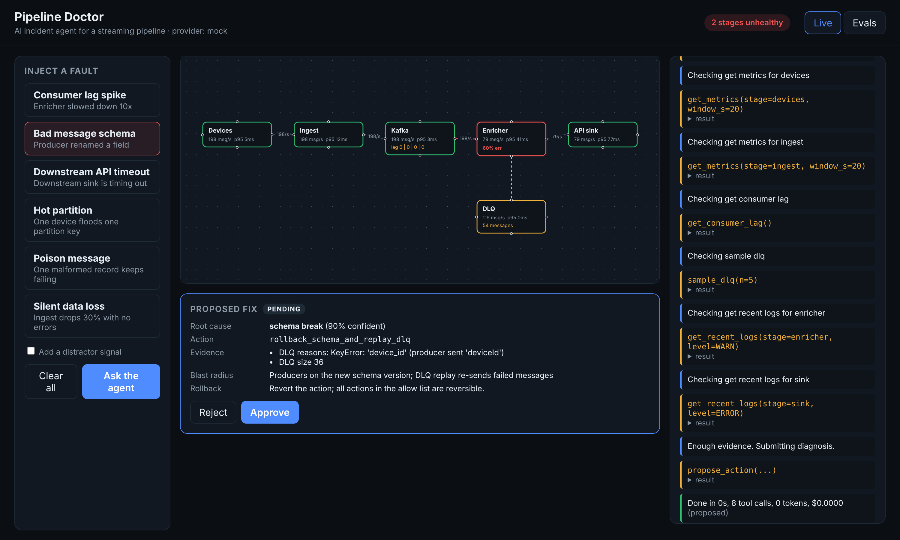

# Pipeline Doctor

An AI incident agent for an event streaming pipeline. Break the pipeline on purpose, watch the agent investigate live, approve its fix, and measure how often it is right.



## What it shows

- **Agents with tool use.** The agent works through 5 read only tools and 1 gated write tool, also exposed over MCP.
- **Human in the loop.** The agent only proposes. A person approves or rejects every fix.
- **Guardrails.** Max 12 tool calls, 60 second limit, action allow list, reversible actions only.
- **Evals.** 6 fault scenarios, each with and without a distractor signal, scored against ground truth.
- **Cost and model comparison.** Tokens and cost tracked per run, per model.

## Quick start (no API key needed)

```bash
# backend
cd backend
python -m venv .venv && source .venv/bin/activate
pip install -r requirements.txt
uvicorn app.main:app --reload --port 8000

# frontend (new terminal)
cd frontend
npm install
npm run dev
```

Open http://localhost:5173. Click a fault, wait a few seconds, then click **Ask the agent**.

By default the agent uses the `mock` provider, a rule based investigator. It is the baseline your LLM agent should beat.

### Use a real model

```bash
export LLM_PROVIDER=anthropic          # or bedrock
export ANTHROPIC_API_KEY=...           # for anthropic
export LLM_MODEL=claude-sonnet-4-5     # any Claude model id you have access to
```

For Bedrock, set AWS credentials and `BEDROCK_MODEL_ID`. Update `PRICES` in `backend/app/llm.py` to get accurate cost numbers.

### Docker

```bash
docker compose up --build
```

## Run evals

From the UI: **Evals** tab, then **Run evals**. From the CLI:

```bash
cd backend
python run_evals.py --provider mock --repeats 5
python run_evals.py --provider anthropic --repeats 5
```

Every run is stored in `backend/traces.db` (SQLite) with the full step trace.

## Use the tools from any MCP client

```bash
cd backend
FAULT=bad_schema python -m app.mcp_server
```

Point Claude Desktop or another MCP client at that command and ask it to investigate.

## Fault scenarios

| Scenario | What breaks | Expected root cause | Expected fix |
| --- | --- | --- | --- |
| consumer_lag | Enricher slows down 10x | slow_consumer | scale_consumers |
| bad_schema | Producer renames a field | schema_break | rollback_schema_and_replay_dlq |
| sink_timeout | Downstream API times out | downstream_timeout | pause_and_retry_with_backoff |
| hot_partition | One device floods one key | hot_partition | rebalance_partition_key |
| poison_message | One bad record keeps failing | poison_message | skip_poison_message |
| silent_drop | Ingest drops 30% with no errors | ingest_data_loss | replay_from_source |

## Layout

```
backend/
  app/simulator.py    in memory pipeline: devices -> ingest -> kafka -> enricher -> sink, plus DLQ
  app/scenarios.py    fault scenarios, ground truth, action allow list
  app/tools.py        agent tools (read tools + gated propose_action)
  app/agent.py        bounded investigation loop with guardrails
  app/llm.py          provider adapter: mock, anthropic, bedrock
  app/traces.py       SQLite trace store and scoreboard queries
  app/evals.py        eval harness
  app/mcp_server.py   same tools over MCP
  app/main.py         FastAPI: REST + Server Sent Events
  tests/              pytest suite
frontend/
  src/components/     PipelineMap, FaultPanel, AgentTimeline, ApprovalCard, Scoreboard
```

## Roadmap

- [ ] Real Kafka mode (docker compose profile `kafka`) behind the same tool interface
- [ ] Combined faults (two at once) to make evals harder
- [ ] LLM judge for evidence quality, with human spot checks
- [ ] Model comparison chart: accuracy versus cost per model
- [ ] Postmortem agent that writes a short incident summary after each fix
